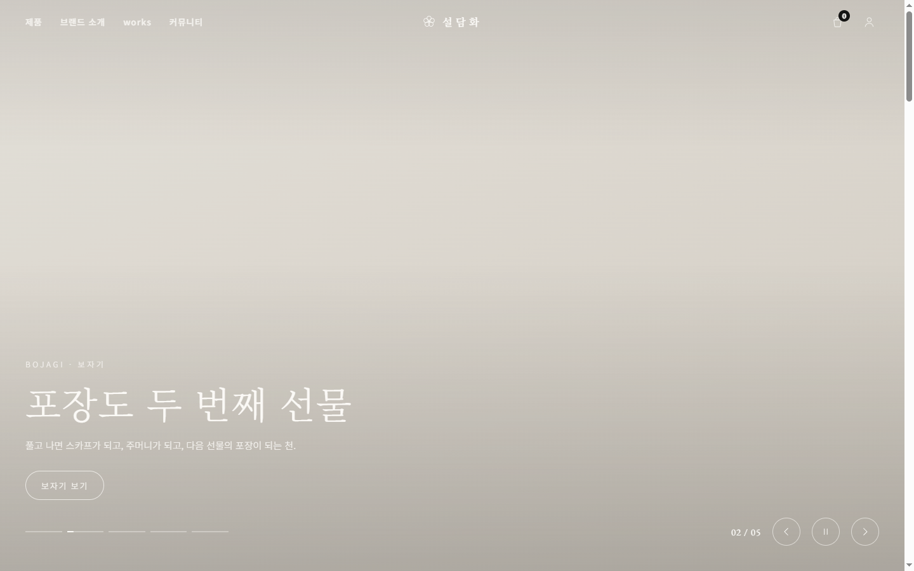
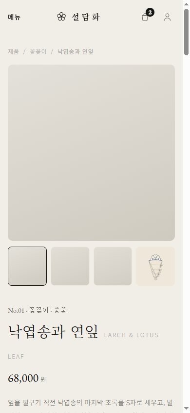
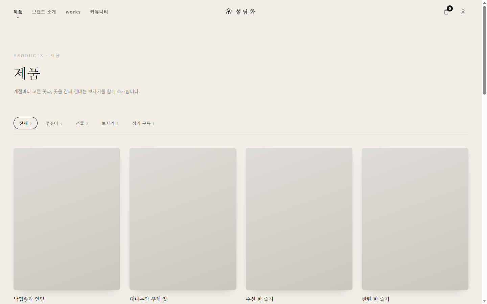
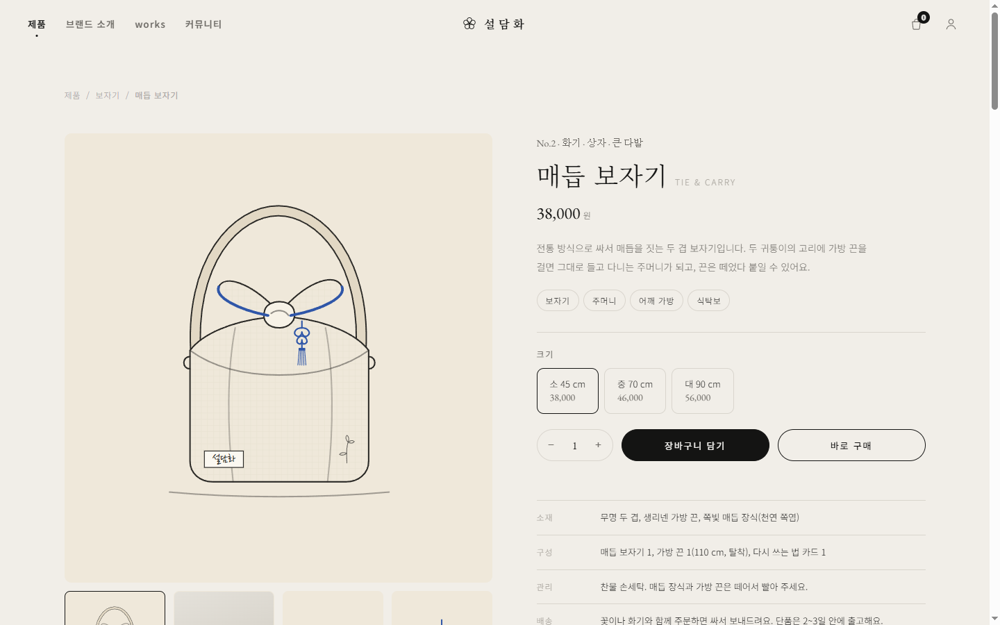
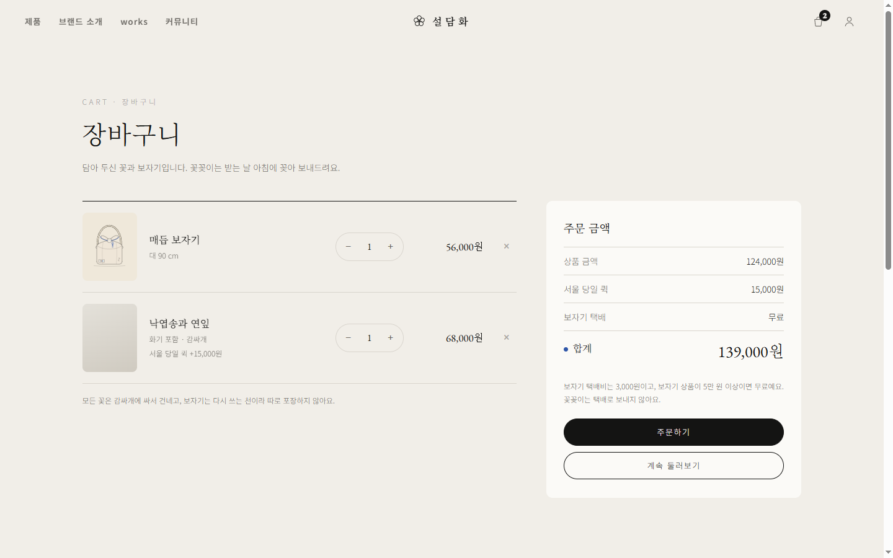
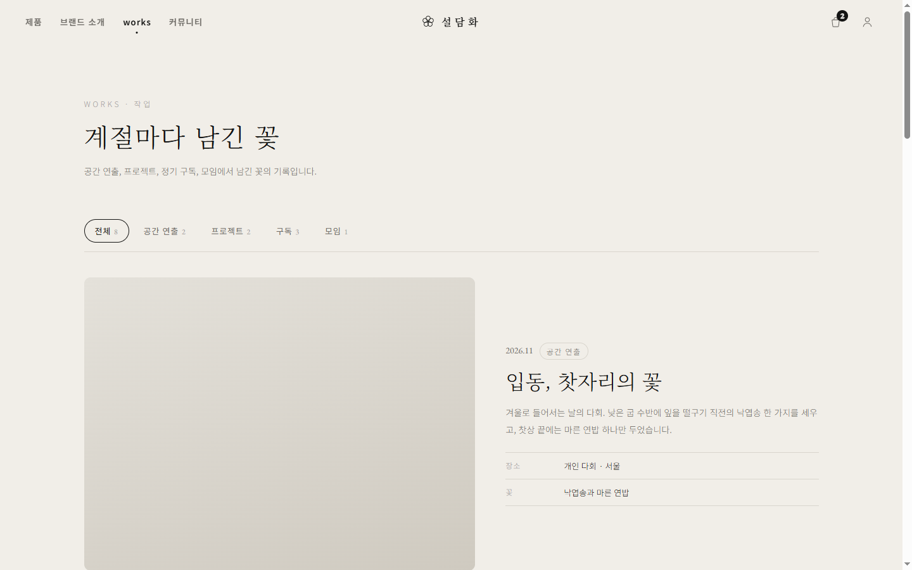
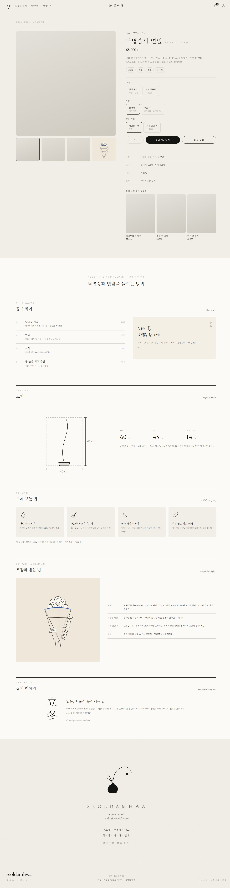

# 설담화 說談話

**꽃으로 건네는 말.** 절기마다 고른 꽃 한 줄기를, 다시 쓰는 보자기에 싸서 건네는 1인 꽃 스튜디오의 브랜드 사이트입니다.


검소하되 누추하지 않고, 화려하되 사치하지 않게(儉而不陋 華而不侈). 한국의 미감을 화면으로 옮기는 것을 목표로 브랜드 정의부터 디자인 시스템, 시안, Next.js 구현까지 한 사람이 진행한 프로젝트입니다.


## Screenshots

| 메인 · 히어로 슬라이더 | 모바일 |
| --- | --- |
|  |  |

| 제품 목록 | 보자기 상세 |
| --- | --- |
|  |  |

| 장바구니 | 작업 기록 |
| --- | --- |
|  |  |

<details>
<summary>꽃꽂이 상세 전체 화면</summary>


</details>

> 화면의 회색 면은 사진 자리입니다. 시안에 쓴 참고 사진은 다른 사람의 사진이라 저장소와 캡처에서 뺐습니다.


## Features

- **큰 이미지 히어로 슬라이더**: 6초마다 넘어가고, 마우스·포커스·탭 숨김에 멈춥니다. 직접 넘길 때는 더 빠르게 반응하고, 동작 줄이기 설정에서는 자동으로 넘기지 않습니다.
- **제품 목록과 카테고리**: 꽃꽂이, 선물, 보자기, 정기 구독. 주소(`/shop?cat=bojagi`)로 바로 들어올 수 있습니다.
- **두 종류의 상세 페이지**
  - 보자기: 크기 선택, 그림 갤러리, 다시 쓰는 법을 담은 01~05 이야기
  - 꽃꽂이: 화기·포장·받는 방법 옵션, 크기 도식(SVG로 계산), 관리법, 절기 이야기
- **장바구니**: 수량 조절, 서울 당일 퀵과 보자기 택배비 계산(5만 원 이상 무료), 브라우저에 저장
- **브랜드 소개 · works · 커뮤니티**: 작업 기록 분류 필터, 꽃 모임 안내
- **손그림 벡터 일러스트**: 연필 선화와 붓 그림을 직접 그려 벡터로 옮겼습니다.
- **접근성**: 12px 최소 글자, 키보드 조작, 스크린리더용 안내, `prefers-reduced-motion` 대응


## Tech Stack

| 구분 | 사용한 것 | 이유 |
| --- | --- | --- |
| 프레임워크 | **Next.js 16** (App Router) | 페이지별 주소, 미리 만든 정적 페이지, 나중에 결제·관리자 화면을 붙일 서버 기능 |
| UI | **React 19**, TypeScript | 옵션 선택·장바구니처럼 상태가 바뀌는 화면을 안전하게 |
| 스타일 | 순수 **CSS** + 디자인 토큰(CSS 변수) | 시안의 CSS를 그대로 옮겨 디자인이 흐트러지지 않게. 라이브러리 없음 |
| 글꼴 | `next/font` (Noto Serif KR, Noto Sans KR, EB Garamond, Nanum Pen Script) | 글꼴을 직접 호스팅해 깜빡임을 줄임 |
| 상태 | React Context + `localStorage` | 장바구니와 알림. 외부 상태 라이브러리 없음 |
| 그림 | 인라인 SVG, `<symbol>` 스프라이트 | 선화를 어떤 크기에서도 선명하게 |
| 시안 | HTML·CSS·바닐라 JS + Python 빌드 스크립트 | 프레임워크 없이 한 파일로 빠르게 확인하던 단계 (`mockups/`) |
| 디자인 문서 | `PRODUCT.md`, `DESIGN.md` | 사용자·원칙·색·글꼴·간격 규칙을 글로 정리 |


## Run Locally

Node.js 20 이상이 필요합니다.

```bash
git clone https://github.com/beang66/seoldamhwa.git
cd seoldamhwa/web
npm install
npm run dev
```

브라우저에서 <http://localhost:3000> 을 엽니다.

배포용으로 빌드해서 실행하려면:

```bash
npm run build
npm run start
```

### 사진 넣기

사진은 저장소에 없습니다. `web/public/img/` 폴더를 만들고 아래 이름으로 사진을 넣으면 화면에 나타납니다. 없으면 회색 면으로 보입니다.

```
bojagi.jpg  dried-box.jpg  field.jpg
ikebana-bamboo.jpg  ikebana-daffodil.jpg  ikebana-larch.jpg  ikebana-nasturtium.jpg
```


## Usage Guide

### 둘러보기

| 주소 | 화면 |
| --- | --- |
| `/` | 메인. 히어로 슬라이더, 이번 계절의 꽃, 보자기, works, 커뮤니티 |
| `/shop` | 제품 목록. `?cat=arrange · gift · bojagi · sub` 로 분류 |
| `/shop/larch` `/shop/bamboo` `/shop/daffodil` `/shop/nasturtium` | 꽃꽂이 상세 |
| `/shop/wrap` `/shop/knot` | 보자기 상세 |
| `/about` · `/works` · `/community` · `/cart` | 브랜드 소개 · 작업 기록 · 꽃 모임 · 장바구니 |

### 주문 흐름 해 보기

1. `/shop/larch` 에서 화기·포장·받는 방법을 고르면 가격이 바로 바뀝니다.
2. **장바구니 담기**를 누르면 헤더의 숫자가 늘고 알림이 뜹니다. **바로 구매**는 장바구니로 바로 이동합니다.
3. `/cart` 에서 수량을 바꾸거나 빼면 상품 금액, 퀵, 택배비, 합계가 다시 계산됩니다.
4. **주문하기**는 아직 결제와 연결되어 있지 않습니다.

### 상품과 가격 바꾸기

상품, 가격, 작업 기록은 모두 [`web/lib/catalog.ts`](web/lib/catalog.ts) 한 파일에 있습니다.

- 꽃꽂이: `ARR` (기본가 `base`, 화기 없이 살 때 빼는 금액 `vesselOff`, 크기 `h·w·v`)
- 보자기: `ITEMS` (크기별 가격 `sizes`)
- 목록 카드: `SHOP`
- 택배비 규칙: [`web/components/Providers.tsx`](web/components/Providers.tsx)의 `SHIP_FEE`, `SHIP_FREE_FROM`

### 디자인 바꾸기

색과 글꼴은 [`web/app/globals.css`](web/app/globals.css) 맨 위의 CSS 변수(`--paper`, `--ink`, `--blue` 등)에서 바꿉니다. 규칙과 이유는 [`DESIGN.md`](DESIGN.md)에 있습니다.


## Project Structure

```
seoldamhwa/
├─ web/                     Next.js 앱
│  ├─ app/                  페이지 (/, shop, shop/[slug], about, works, community, cart)
│  ├─ components/           헤더, 히어로 슬라이더, 상세, 장바구니 등
│  │  └─ static/            시안 HTML에서 옮긴 정적 화면과 손그림 SVG
│  └─ lib/catalog.ts        상품·가격·작업 기록 데이터
├─ mockups/                 프레임워크 없이 만든 HTML 시안과 빌드 스크립트
│  └─ src/illust/           손그림 벡터와 그리는 스크립트
├─ docs/screenshots/        README 캡처
├─ PRODUCT.md               누구를 위한 사이트인지, 브랜드 원칙
└─ DESIGN.md                디자인 시스템 (색, 글꼴, 간격, 컴포넌트, 금지 사항)
```


## Design Notes

- **색**: 한지(#F1EEE8)와 먹(#141413)의 농담을 바탕으로 하고, 쪽빛(#2F56A8)은 한 화면에 한 점만 씁니다. 검은 바탕은 쓰지 않습니다.
- **글꼴**: 제목은 바탕체(Noto Serif KR), 본문은 돋움체(Noto Sans KR), 영문은 EB Garamond, 손글씨는 나눔펜. 가장 작은 글자도 12px(9pt)입니다.
- **움직임**: 감상하는 부분(히어로, 나타나기)은 느리게, 누르는 부분(버튼, 페이지 이동)은 빠르게. 버튼은 눌린 순간 97%로 들어갑니다.
- **깊이**: 면은 평평하게 두고, 카드와 포스터처럼 '놓인 것'만 종이 한 장만큼 떠오르게 합니다.


## Roadmap

- [ ] 상품·주문 데이터를 DB로 옮기고, 금액은 서버에서 다시 계산
- [ ] 토스페이먼츠 결제 연결 (테스트 키부터)
- [ ] 회원 로그인과 마이페이지
- [ ] 관리자 화면 (주문 상태, 상품·가격, 모임 신청)
- [ ] 직접 촬영한 사진으로 교체


## Author

설담화 · 브랜드, 디자인, 개발
