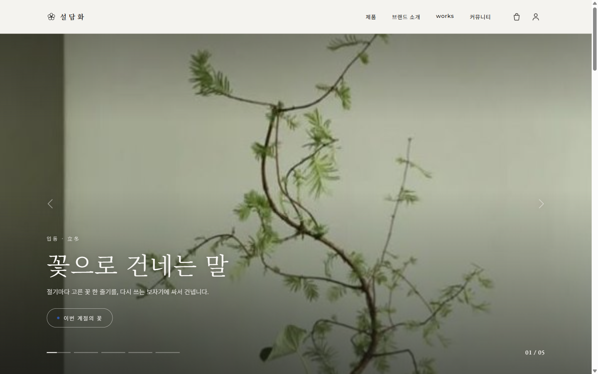
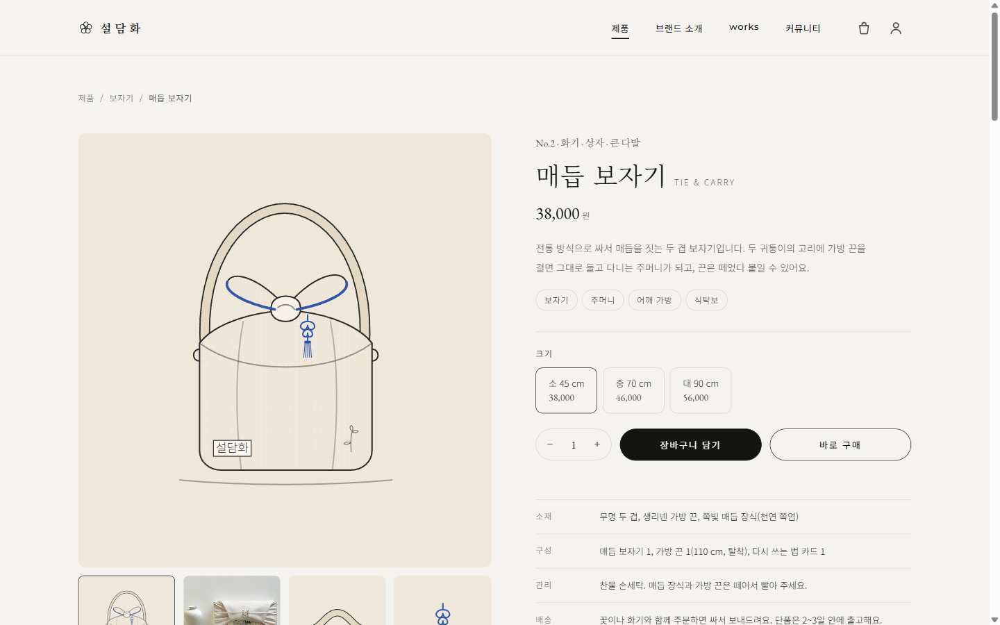
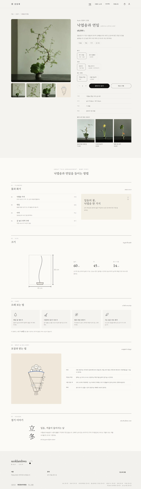
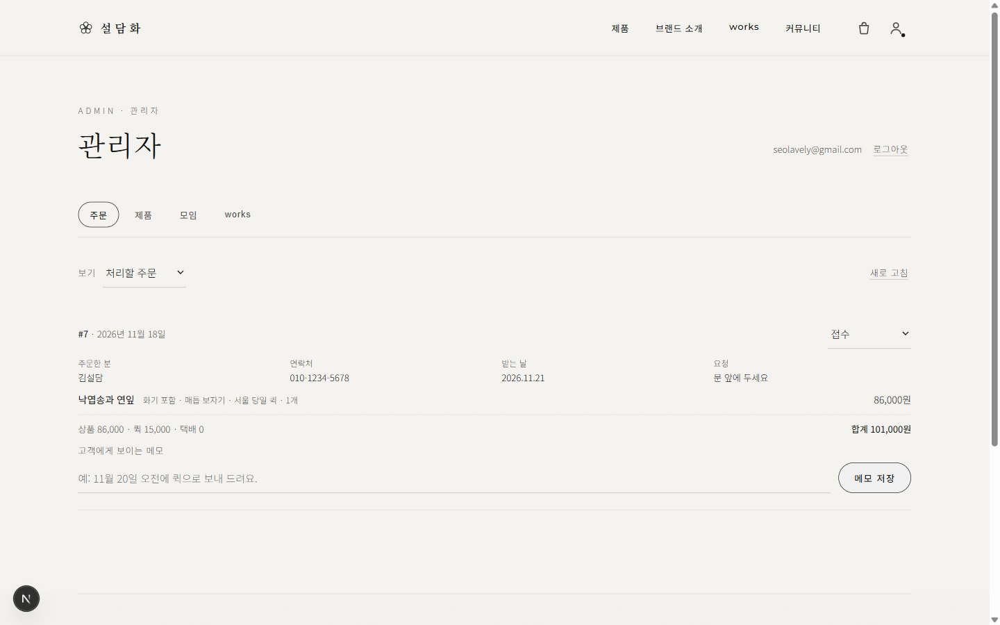
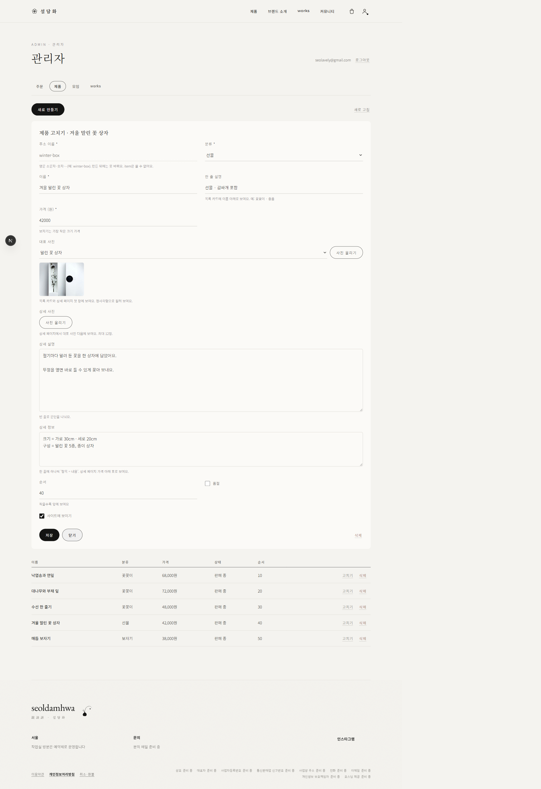

# 설담화 說談話

절기마다 고른 꽃 한 줄기를 다시 쓰는 보자기에 싸서 건네는 1인 꽃 스튜디오의 브랜드 웹사이트입니다.

꽃꽂이와 보자기를 고르고 옵션·받는 날을 정해 주문을 넣을 수 있고, 대표는 관리자 페이지에서 주문·상품·사진·모임·작업 기록을 직접 관리합니다.

[배포 사이트](https://beang66.github.io/seoldamhwa/) · [제품 정의](PRODUCT.md) · [디자인 시스템](DESIGN.md) · [데이터 구조](docs/erd.md)


| 화면 | 상품 | DB 테이블 | 관리자 탭 |
| --- | --- | --- | --- |
| 14종 (주소 19개) | 9개 | 6개 | 4개 |



## 목차

1. [개요](#1-개요)
2. [기획 배경](#2-기획-배경)
3. [기술 스택과 배포 구조](#3-기술-스택과-배포-구조)
4. [주요 기능](#4-주요-기능)
5. [기술적 의사결정](#5-기술적-의사결정)
6. [프로젝트 구조와 데이터 모델](#6-프로젝트-구조와-데이터-모델)
7. [실행 방법](#7-실행-방법)
8. [검증 결과](#8-검증-결과)
9. [회고와 향후 계획](#9-회고와-향후-계획)

## 1. 개요

| 항목 | 내용 |
| --- | --- |
| 목표 | 꽃과 '다시 쓰는 보자기'를 함께 고르고 주문하는 경험을 브랜드의 미감 그대로 웹에 옮긴다 |
| 원칙 | 검소하되 누추하지 않고, 화려하되 사치하지 않게(儉而不陋 華而不侈) · 쪽빛은 한 화면에 한 점만 · 금액은 서버가 계산 |
| 대상 | 꽃 선물을 고르는 손님, 혼자 운영하는 대표 |
| 기간 | 2026.10.29 대표 인터뷰 – 2026.11.18 |
| 역할 | 브랜드 기획·BI/CI·디자인 판단·클라이언트 협의·검수: 안정빈 / 구현: Claude Code / 브랜드 방향 결정: 설담화 대표 |
| 실행 환경 | 정적 사이트(GitHub Pages) + Supabase(서울 리전), 데스크톱·모바일 브라우저 |

## 2. 기획 배경

| 문제 | 왜 문제인가 | 해결 |
| --- | --- | --- |
| 꽃 선물의 포장은 한 번 쓰고 버려진다 | 대표 인터뷰(2026-10-29)에서 브랜드의 출발점으로 확인 | 꽃꽂이에 보자기 포장을 옵션으로 붙이고, 보자기만 따로 살 수 있게 함 |
| 꽃은 받는 날과 받는 방법이 중요하다 | 같은 상품도 화기·포장·퀵 여부에 따라 값이 달라짐 | 옵션별로 금액을 바로 계산하고, 받는 날은 내일부터 고르게 함 |
| 상품·가격·사진이 절기마다 바뀐다 | 혼자 운영하는 대표가 코드를 고칠 수 없음 | 관리자 페이지에서 상품·사진·상세 설명·모임·works를 등록·수정·삭제 |
| 정적 사이트에는 서버가 없다 | 브라우저가 계산한 금액은 손님이 바꿀 수 있음 | 주문 금액을 DB 함수가 다시 계산하고, 권한은 DB 정책(RLS)이 정함 |

## 3. 기술 스택과 배포 구조

| 구분 | 기술 | 역할 |
| --- | --- | --- |
| 화면 | Next.js 16 (App Router, 정적 내보내기), React 19, TypeScript | 페이지별 주소, 미리 만든 정적 페이지 |
| 스타일 | 순수 CSS + 디자인 토큰(CSS 변수) | 바탕 #F4F3EF, 먹색 글자, 쪽빛 #2F56A8, 본문 폭 1200px |
| 글꼴 | Noto Serif KR · Noto Sans KR · EB Garamond · Montserrat (`next/font`) | 제목 · 본문 · 영문과 숫자 · 제품 목록의 이름과 가격 |
| 데이터·회원 | Supabase (Postgres, Auth, Storage, Edge Function) | 회원·주문·상품·사진·알림 |
| 배포 | GitHub Actions → GitHub Pages | `main`에 푸시하면 빌드·배포 |

```
브라우저 ─ GitHub Pages (정적 페이지)
   │  장바구니는 브라우저 localStorage
   └─ 공개 키로 Supabase 접속
        ├─ Auth         이메일 가입·로그인·메일 인증
        ├─ Postgres     RLS 정책으로 읽기·쓰기 권한 결정
        │   └─ price_lines → quote_order(금액 미리 보기) → place_order(주문 접수)
        ├─ Storage      works · products 사진 (관리자만 올림)
        └─ Edge Function notify-new-order (새 주문 메일, 메일 서비스 키로 켬)
```

| 주요 DB 함수 | 하는 일 |
| --- | --- |
| `quote_order` | 장바구니 내용을 지금 가격으로 다시 계산 |
| `place_order` | 금액을 다시 계산해 화면 합계와 같을 때만 주문 접수 |
| `cancel_my_order` | 손님이 '접수' 단계의 자기 주문을 취소 |
| `delete_my_account` | 탈퇴. 계정은 지우고 주문은 계정과 분리해 5년 보관 |
| `is_admin` | 등록된 이메일 중 메일 인증을 마친 계정만 관리자로 판단 |

## 4. 주요 기능

### 메인

| 데스크톱 | 모바일 |
| --- | --- |
|  |  |

- 헤더 아래 사진 슬라이더. 6초마다 왼쪽으로 넘어가고, 위치 바를 누르면 그 장으로 이동
- 이번 절기의 꽃, 다시 쓰는 보자기, works, 커뮤니티로 이어지는 한 줄 흐름

### 제품 목록


- 꽃꽂이·선물·보자기·정기 구독 분류, 기본 순서·가격순 정렬
- 한 줄에 3개, 정사각 사진. 분류는 주소(`/shop?cat=bojagi`)에 남음

### 상품 상세



- 보자기는 크기, 꽃꽂이는 화기·포장·받는 방법을 고르면 금액이 바로 바뀜
- 관리자가 등록한 상품은 대표·상세 사진, 상세 설명, 상세 정보 표로 상세 페이지가 만들어짐(`/shop/item?k=주소이름`)

<details>
<summary>꽃꽂이 상세 전체 화면</summary>


</details>

### 장바구니·주문


- 수량을 바꾸면 상품 금액, 서울 당일 퀵, 보자기 택배비(5만 원 이상 무료), 합계를 다시 계산. 뺀 상품은 알림에서 되돌리기
- 주문하기 → 로그인 → 받는 분·연락처·받는 날 입력 → 서버가 금액을 다시 확인한 뒤 접수

### works


- 공간 연출·프로젝트·구독·모임 분류로 작업 기록을 모아 봄. 고른 분류는 주소에 남음

### 로그인·마이페이지


- 이메일 가입·로그인·비밀번호 찾기
- 마이페이지에서 주문 내역, 접수 단계 주문 취소, 이름·연락처 수정, 탈퇴

### 관리자

| 주문 | 제품 목록 |
| --- | --- |
|  |  |



- 주문 상태 변경과 손님에게 보이는 메모
- 제품·모임·works 등록·수정·삭제, 대표·상세 사진 올리기, 상세 설명·상세 정보 입력
- 저장하지 않고 다른 탭으로 가면 확인을 받음

### 전체 주소

| 주소 | 화면 |
| --- | --- |
| `/` | 메인 |
| `/shop` | 제품 목록 |
| `/shop/larch` `/shop/bamboo` `/shop/daffodil` `/shop/nasturtium` | 꽃꽂이 상세 |
| `/shop/wrap` `/shop/knot` | 보자기 상세 |
| `/shop/item?k=주소이름` | 관리자가 등록한 상품의 상세 |
| `/about` · `/works` · `/community` · `/cart` | 브랜드 소개 · 작업 기록 · 꽃 모임 · 장바구니 |
| `/login` · `/mypage` · `/admin` | 로그인·회원가입 · 마이페이지 · 관리자 |
| `/terms` · `/privacy` · `/refund` | 이용약관 · 개인정보처리방침 · 취소·환불 |

## 5. 기술적 의사결정

| 채택안 | 검토한 대안 | 이유 | 결정 |
| --- | --- | --- | --- |
| 브랜드 방향 C안: 아이보리 바탕, 블루 포인트, 손글씨 한글 로고, 미니멀 손그림, 음각·양각 | A안(선과 여백의 갤러리풍), B안(먹색·쪽빛 대비) | A는 고객층이 좁고 차가울 수 있고, B는 차갑고 각진 느낌. C가 따뜻하면서 차분함 | 설담화 대표, 2026-11-06 |
| 직접 개발(Next.js + Supabase) | 카페24 + 맞춤 스킨, 아임웹 | 플랫폼은 결제·배송·회원을 기본 제공하지만 손그림·세로 문장 같은 디자인 세부를 타협함 | 개발. 출시 플랫폼은 대표가 정함 |
| 주문 금액을 DB 함수가 다시 계산 | 브라우저가 계산한 금액을 그대로 저장 | 브라우저 값은 바꿀 수 있음. 화면 합계와 다르면 주문을 막고 지금 가격으로 고쳐 보여 줌 | 개발 |
| 탈퇴 시 계정은 바로 지우고 주문은 계정과 분리해 5년 보관 | 주문까지 바로 삭제 | 전자상거래법의 거래 기록 보관 의무. 기간이 지나면 정리 함수로 삭제 | 개발 |
| 관리자 등록 상품의 상세 페이지를 `?k=` 주소 하나로 | 상품마다 정적 페이지 생성 | 정적 사이트라 새 상품 페이지를 빌드 없이 만들 수 없음 | 개발 |
| 제목은 명조 유지, 제품 목록만 Montserrat | 전체를 고딕(Noto Sans KR + Inter Tight)으로 교체 | 교체해 비교한 뒤 기존 명조의 인상이 브랜드에 더 맞음 | 안정빈, 2026-11-18 |
| 메인의 손그림 선화를 사진으로, 배경은 한 가지 색으로 | 선화와 섹션별 배경색 유지 | 선화·세로쓰기·한자·배경색이 겹쳐 화면이 산만해 보임 | 안정빈, 2026-11-18 |

## 6. 프로젝트 구조와 데이터 모델

```
seoldamhwa/
├─ web/                Next.js 앱
│  ├─ app/             페이지 (전체 주소 표)
│  ├─ components/      헤더·히어로·상세·장바구니·주문·로그인·마이페이지·관리자
│  ├─ lib/             catalog.ts(기본 데이터) · data.ts(DB 읽기) · supabase.ts · business.ts(사업자 정보)
│  └─ public/img/      사진 7장
├─ supabase/           마이그레이션 5개, 시드, Edge Function, 설정 안내
├─ docs/               erd.md, screenshots/
├─ mockups/            첫 HTML 시안
├─ PRODUCT.md          사용자와 브랜드 원칙
└─ DESIGN.md           색·글꼴·간격·컴포넌트 규칙
```

| 테이블 | 내용 |
| --- | --- |
| `admins` | 관리자 이메일 |
| `profiles` | 회원 이름·연락처 (가입 때 자동 생성) |
| `products` | 상품 이름·분류·가격·크기별 가격·사진·상세 사진·상세 설명·상세 정보·품절·숨김·순서 |
| `orders` | 주문자·받는 날·상품 줄·금액·상태(접수·확인·준비 중·완료·취소)·관리자 메모 |
| `gatherings` | 꽃 모임 일정·장소·정원·참가비 |
| `works` | 작업 기록 연월·분류·제목·사진 |

주문 한 건의 상품 줄(`orders.items`)은 이렇게 저장됩니다.

```json
{ "key": "larch", "name": "낙엽송과 연잎", "opt": "화기 포함 · 감싸개 · 서울 당일 퀵", "unit": 68000, "qty": 1, "quick": 15000 }
```

관계도는 [`docs/erd.md`](docs/erd.md)에 있습니다.

## 7. 실행 방법

Node.js 20 이상이 필요합니다.

```bash
git clone https://github.com/beang66/seoldamhwa.git
cd seoldamhwa/web
npm install
npm run dev        # http://localhost:3000
```

정적 파일 빌드는 `npm run build`이고, 결과는 `web/out/`에 만들어집니다.

| 환경 변수 | 필수 | 설명 |
| --- | --- | --- |
| `NEXT_PUBLIC_SUPABASE_URL` | 로그인·주문을 쓸 때 | Supabase 프로젝트 주소 |
| `NEXT_PUBLIC_SUPABASE_PUBLISHABLE_KEY` | 로그인·주문을 쓸 때 | 공개(publishable) 키. `web/.env.development`·`.env.production`에 있음 |
| `NEXT_PUBLIC_BASE_PATH` | 하위 경로에 배포할 때 | 예: `/seoldamhwa` |

DB 만들기, 마이그레이션 순서, 관리자 등록, 다른 Supabase 계정으로 옮기기, 메일 알림 켜기는 [`supabase/README.md`](supabase/README.md)에 있습니다.

## 8. 검증 결과

| 항목 | 방법 | 결과 |
| --- | --- | --- |
| 타입 검사 | `npx tsc --noEmit` | 통과 |
| 린트 | `npx eslint .` | 오류 3건 (`react-hooks/set-state-in-effect`: 헤더, 히어로, 장바구니 저장) |
| 프로덕션 빌드 | 새로 받은 저장소에서 `npm ci` → `npm run build` (Node 24.20, `NEXT_PUBLIC_BASE_PATH=/seoldamhwa`) | 성공, 정적 페이지 22개 |
| 의존성 보안 | `npm audit --omit=dev` | 취약점 0건 |
| DB 권한·주문 함수 | 트랜잭션 안에서 손님·관리자·비로그인 역할로 SQL 실행 후 되돌림 | 비로그인은 주문을 못 읽음, 손님은 자기 주문만 봄, 서버 금액 재계산, 탈퇴 시 주문 분리 보관, 기간 지난 주문 정리 |
| Supabase 보안 점검 | Supabase 보안 어드바이저 | 주문·취소·탈퇴·관리자 확인 함수 공개(함수 안에서 본인·관리자 확인), `admins` 정책 없음(직접 접근 차단), 유출 비밀번호 차단 꺼짐 |
| 화면 흐름 | Playwright, Supabase 응답 모의, 1440px·390px | 옵션 선택 → 장바구니 → 로그인 이동 → 틀린 비밀번호 안내 → 주문 접수(바뀐 가격 반영) → 마이페이지 → 관리자 로그인 → 주문 상태 변경 → 제품 수정 통과 |
| 레이아웃 | 브라우저 1440·1680px, 모바일 375px | 가로 넘침 없음, 좌우 여백 대칭, 섹션 구분선 폭 1200px 통일, 위치 바 이동·가격순 정렬 동작 |
| 확인하지 않은 범위 | — | 실제 관리자 계정의 사진 업로드, 결제, 실제 메일 발송, GitHub Actions 배포 |

## 9. 회고와 향후 계획

| Keep | Problem | Try |
| --- | --- | --- |
| 서버 없는 정적 사이트에서도 금액 재계산과 RLS로 주문 데이터를 지킴 | 선화·세로쓰기·한자·섹션별 배경색을 한꺼번에 써서 화면이 산만해짐 | 대표가 플랫폼·결제 방식·상품·가격을 정하면 결제를 붙이거나 플랫폼으로 옮김 |
| 클라이언트가 정할 일을 기능 정의서 18개 항목으로 따로 모음 | 글꼴 전체 교체를 비교 없이 적용했다가 되돌림 | 직접 촬영한 사진으로 바꾸고 관리자 사진 업로드를 실제 계정으로 확인 |
| 화면을 브라우저에서 직접 재고(여백·구분선·넘침) 반영 | 개발용 DB 하나에 시험 주문이 섞임, 린트 오류 3건 | 운영용 DB 분리, 도메인, 메일 서비스, 유출 비밀번호 차단 켜기, 린트 정리 |
