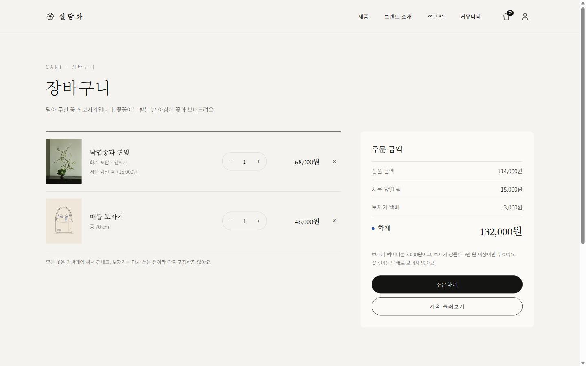
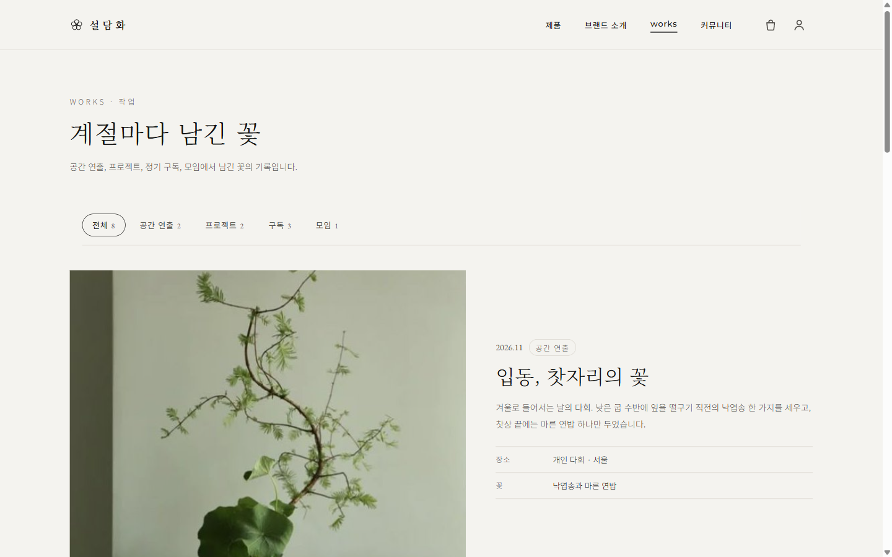
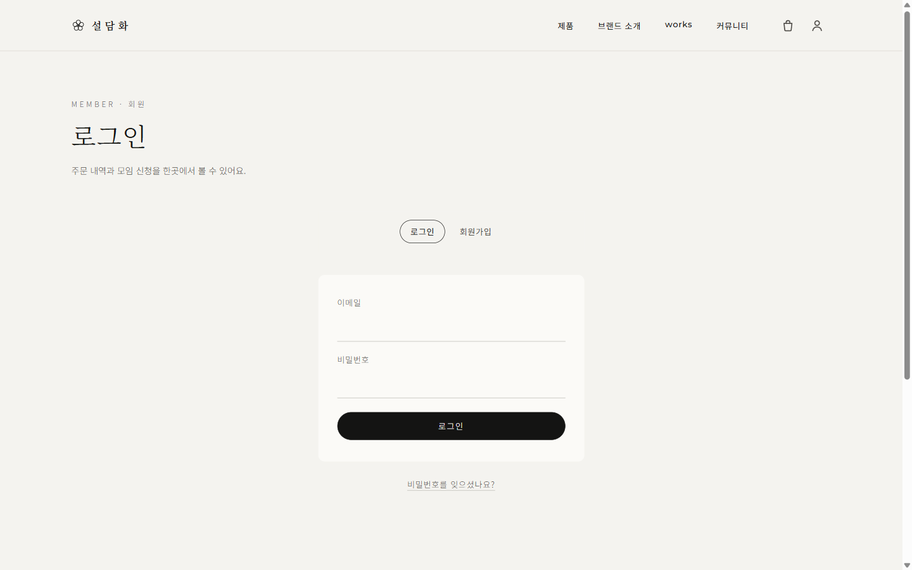

# 설담화 說談話 — 꽃과 보자기 브랜드 웹사이트

> **절기마다 고른 꽃 한 줄기를 다시 쓰는 보자기에 싸서 건네는 1인 꽃 스튜디오의 브랜드 사이트이자, 주문 접수까지 되는 작은 쇼핑몰입니다.**
>
> **현재 상태:** 회원가입·로그인, 주문 접수(금액은 서버가 다시 계산), 마이페이지, 관리자 페이지가 동작하는 시안 단계입니다. **결제는 연결되어 있지 않고**, 상품·가격·사진·사업자 정보는 아직 확정 전입니다. 마지막 확인 2026-11-18.
> **역할:** 안정빈 — 브랜드 기획·BI/CI·디자인 판단·클라이언트 협의·검수 / 구현은 Claude Code(AI)를 사용
> **화면:** [beang66.github.io/seoldamhwa](https://beang66.github.io/seoldamhwa/) (`main` 브랜치 기준) · **설계 문서:** [`PRODUCT.md`](PRODUCT.md) · [`DESIGN.md`](DESIGN.md) · [`docs/erd.md`](docs/erd.md)


검소하되 누추하지 않고, 화려하되 사치하지 않게(儉而不陋 華而不侈).

## 1. 문제와 목표

| 누가 / 언제 | 확인된 문제 (근거) | 사이트에서 바꾸는 행동 |
| --- | --- | --- |
| 꽃 선물을 고르는 손님 | 꽃 선물의 포장은 한 번 쓰고 버려진다 (2026-10-29 대표 인터뷰) | 꽃과 '다시 쓰는 보자기'를 함께 고르고, 받는 날과 받는 방법까지 정해 주문을 넣는다 |
| 1인으로 운영하는 대표 | 상품·가격·사진이 절기마다 바뀐다 | 코드를 고치지 않고 관리자 페이지에서 상품·사진·상세 설명·모임·작업 기록을 바꾼다 |

**확정되지 않은 것:** 출시 상품 구성은 정부지원사업 결과(12월 중순)에 따라 Plan A(패키징) 또는 Plan B(꽃 상품)로 정해집니다. 화면의 상품과 가격은 그 전까지 시안입니다.

## 2. 사용 흐름

**손님**
1. 상품을 고르고 옵션을 정한다. 꽃꽂이는 화기·포장·받는 방법, 보자기는 크기를 고른다.
2. 장바구니에서 수량을 바꾸면 상품 금액, 퀵, 택배비, 합계가 다시 계산된다.
3. 주문하기를 누르면 로그인으로 넘어가고, 받는 분·연락처·받는 날을 적어 주문을 넣는다. 금액은 DB가 지금 가격으로 다시 계산해서 화면과 다르면 알려 준다.
4. 마이페이지에서 주문 상태를 보고, 접수 단계의 주문은 직접 취소한다.

**관리자**
1. 관리자로 등록된 이메일로 가입하고 메일 인증을 마치면 사람 아이콘이 관리자 페이지로 열린다.
2. 주문 상태를 바꾸고 손님에게 보이는 메모를 남긴다.
3. 제품의 대표·상세 사진을 올리고 상세 설명과 상세 정보를 적으면, 그 내용으로 상세 페이지(`/shop/item?k=주소이름`)가 만들어진다.

## 3. 기능과 현재 상태

| 기능 | 손님·대표에게 주는 것 | 상태 | 근거 |
| --- | --- | --- | --- |
| 브랜드·상품 화면 | 메인, 제품 목록(분류·가격순 정렬), 꽃꽂이·보자기 상세, 브랜드 소개, works, 커뮤니티 | 구현, 브라우저 확인 | `web/app/`, 아래 화면 |
| 장바구니·주문 접수 | 옵션별 금액 계산, 서버 금액 재계산, 받는 날은 내일부터 | 구현, 화면 흐름 시험 | `web/components/OrderForm.tsx`, `price_lines`·`place_order` |
| 회원 | 가입·로그인·비밀번호 찾기, 마이페이지(주문 내역·취소·정보 수정·탈퇴) | 구현, 화면 흐름 시험 | `web/components/LoginForm.tsx`, `MyPage.tsx` |
| 관리자 | 주문 상태·메모, 제품·모임·works 등록·수정·삭제, 제품 사진 업로드와 상세 페이지 내용 | 구현. **실제 관리자 계정으로 사진 업로드는 미확인** | `web/components/admin/Admin.tsx` |
| 법적 표시 | 이용약관·개인정보처리방침·취소·환불 초안, 푸터 사업자 정보 9개 항목 | 초안. 값은 '준비 중' | `web/lib/business.ts` |

**하지 않는 것 / 알려진 한계:** 결제(PG)·무통장 입금 확인, 소셜 로그인, 비회원 주문, 모임 신청 접수, 알림 메일(코드는 있으나 메일 서비스 키가 없어 꺼짐), 설담화 디자인의 404 페이지.

## 4. 화면

| 메인 · 히어로 슬라이더 | 모바일 |
| --- | --- |
|  |  |

| 제품 목록 | 보자기 상세 |
| --- | --- |
|  |  |

| 장바구니 | 작업 기록 |
| --- | --- |
|  |  |

<details>
<summary>꽃꽂이 상세 전체 화면</summary>


</details>

| 로그인 | 관리자 · 주문 |
| --- | --- |
|  |  |

| 관리자 · 제품 목록 | 관리자 · 제품 사진·상세 등록 |
| --- | --- |
|  |  |

> 캡처는 2026-11-18 기준 화면이고, 시안 사진이 들어간 상태입니다. 관리자 화면은 예시 데이터로 찍었습니다.
> 사진(`web/public/img/`)은 시안용입니다. `bojagi.jpg`는 다른 사람의 사진(워터마크 있음)이라 공개 전에 반드시 직접 찍은 사진으로 바꿔야 합니다.

### 주소

| 주소 | 화면 |
| --- | --- |
| `/` | 메인. 히어로 슬라이더, 이번 계절의 꽃, 보자기, works, 커뮤니티 |
| `/shop` | 제품 목록. `?cat=arrange · gift · bojagi · sub`로 분류 |
| `/shop/larch` `/shop/bamboo` `/shop/daffodil` `/shop/nasturtium` | 꽃꽂이 상세 (기본 상세 페이지) |
| `/shop/wrap` `/shop/knot` | 보자기 상세 (기본 상세 페이지) |
| `/shop/item?k=주소이름` | 관리자가 등록한 사진·설명으로 그리는 상세 페이지 |
| `/about` · `/works` · `/community` · `/cart` | 브랜드 소개 · 작업 기록 · 꽃 모임 · 장바구니 |
| `/login` · `/mypage` · `/admin` | 로그인·회원가입 · 마이페이지 · 관리자 |
| `/terms` · `/privacy` · `/refund` | 이용약관 · 개인정보처리방침 · 취소·환불 |

### 내용 바꾸기

- **상품·가격·사진·모임·works:** 관리자 페이지에서 바꿉니다. DB에 연결하지 않고 실행하면 [`web/lib/catalog.ts`](web/lib/catalog.ts)의 시안 데이터가 대신 보입니다.
- **사업자 정보:** [`web/lib/business.ts`](web/lib/business.ts) 한 곳을 채우면 푸터와 약관 세 페이지에 함께 들어갑니다.
- **색·글꼴·간격:** [`web/app/globals.css`](web/app/globals.css) 맨 위의 CSS 변수에서 바꾸고, 규칙과 이유는 [`DESIGN.md`](DESIGN.md)에 있습니다.

## 5. 설계와 기술

```
브라우저 (GitHub Pages 정적 사이트, Next.js export)
  ├─ 공개 화면: 제품·works·모임을 DB에서 읽고, 실패하면 코드 안의 시안 데이터로 보여 줌
  ├─ 장바구니: 이 브라우저의 localStorage에만 저장
  └─ 공개(publishable) 키로 Supabase에 접속
        ├─ Auth: 이메일 가입·로그인·메일 인증
        ├─ Postgres + RLS: 누가 무엇을 읽고 쓰는지 DB가 정함
        │    └─ 주문 함수: price_lines → quote_order(미리 보기) → place_order(접수, 금액 재계산)
        ├─ Storage: works·products 사진 (관리자만 올림)
        └─ Edge Function: 새 주문 메일 알림 (메일 서비스 키 필요, 지금은 꺼짐)
```

| 계층 | 기술 | 맡는 일 |
| --- | --- | --- |
| 화면 | Next.js 16 (App Router, `output: 'export'`), React 19, TypeScript | 페이지별 주소, 미리 만든 정적 페이지 |
| 스타일 | 순수 CSS + 디자인 토큰(CSS 변수) | 라이브러리 없이 시안의 디자인을 그대로 |
| 글꼴 | `next/font` — Noto Serif KR(제목), Noto Sans KR(본문), EB Garamond(영문·숫자), Montserrat(제품 목록의 이름·가격) | 직접 호스팅 |
| 데이터·회원 | Supabase (Postgres, Auth, Storage, Edge Function) | 서버 없이 회원·주문·관리 데이터를 다룸 |
| 배포 | GitHub Actions → GitHub Pages | `main`에 푸시하면 빌드·배포 |

```
seoldamhwa/
├─ web/                     Next.js 앱
│  ├─ app/                  페이지 (위 '주소' 표)
│  ├─ components/           헤더·히어로·상세·장바구니·주문·로그인·마이페이지·관리자
│  ├─ lib/                  catalog.ts(시안 데이터) · data.ts(DB 읽기) · supabase.ts · business.ts
│  └─ public/img/           시안 사진 7장
├─ supabase/                마이그레이션, 시드, Edge Function, 설정 안내(README)
├─ docs/                    erd.md(데이터 구조), screenshots/(README 캡처)
├─ mockups/                 프레임워크 없이 만든 첫 HTML 시안
├─ PRODUCT.md               누구를 위한 사이트인지, 브랜드 원칙
└─ DESIGN.md                디자인 시스템 (색, 글꼴, 간격, 컴포넌트, 금지 사항)
```

**디자인 요약:** 흰빛 도는 회베이지(#F4F3EF) 바탕과 먹색 글자, 쪽빛(#2F56A8)은 한 화면에 한 점만. 넓은 화면에서도 본문 폭은 1200px로 두고 나머지는 좌우 여백. 카드는 그림자와 둥근 모서리 없이 평평하게. 감상하는 움직임(히어로)은 느리게, 누르는 반응은 빠르게.

## 6. 핵심 의사결정

결정한 사람과 근거는 클라이언트 노션 포털의 '확정된 결정사항', 'BI/CI 시안과 피드백', '웹사이트 기능 정의서'에 기록되어 있습니다(비공개).

| 결정 | 고려한 대안 | 이유·제약 | 결정 |
| --- | --- | --- | --- |
| 브랜드 방향은 **C안**(아이보리 바탕·블루 포인트·손글씨 한글 로고·미니멀 손그림·음각/양각) | A안(선과 여백의 갤러리풍), B안(먹색·쪽빛 대비) | A는 고객층이 좁고 차가울 수 있고, B는 차갑고 각진 느낌이 확인됨. C가 따뜻하면서 차분함 | 대표, 2026-11-06 회의. **방향 승인**이며 최종 로고·적용물 승인은 아님 |
| 쇼핑몰을 **직접 개발**(Next.js + Supabase)로 만들어 둠 | 카페24 + 맞춤 스킨, 아임웹 | 플랫폼은 결제·배송·회원을 기본 제공하지만 디자인 세부를 타협함. 기능 정의서의 추천안은 카페24 + 맞춤 스킨 | **대표 결정 대기.** 플랫폼을 고르면 회원·주문·관리자는 플랫폼 기능으로 바뀌고 디자인은 스킨으로 옮김 |
| 주문 금액을 **DB 함수가 다시 계산** | 브라우저가 계산한 금액을 그대로 저장 | 브라우저 값은 손님이 바꿀 수 있음. 화면 합계와 다르면 주문을 막고 지금 가격으로 고쳐 보여 줌 | 개발(안정빈) |
| 탈퇴하면 계정은 바로 지우고 **주문은 계정과 분리해 5년 보관** | 주문까지 바로 삭제 | 전자상거래법상 계약·결제 기록 보관 의무. 보관 기간이 끝나면 정리 함수로 삭제 | 개발. 정확한 항목·기간은 개인정보처리방침 확정 때 전문가 확인 권장 |
| 관리자 등록 상품의 상세 페이지를 `?k=` 주소 하나로 | 상품마다 정적 페이지 생성 | GitHub Pages는 서버가 없어 새 상품의 페이지를 빌드 없이 만들 수 없음 | 개발 |
| 제목은 **명조 유지** | 전부 고딕(Noto Sans KR + Inter Tight)으로 교체 | 교체해 본 뒤 기존 인상이 더 낫다고 판단해 되돌림. 제품 목록 카드에만 Montserrat 적용 | 안정빈, 2026-11-18 |
| 메인의 손그림 선화를 **사진으로** 바꾸고 배경을 한 가지 색으로 | 선화·섹션별 배경색 유지 | 선화와 사진의 결이 달라 화면이 산만해 보임 | 안정빈, 2026-11-18. 손그림은 상세 페이지 일부에 남음 |

## 7. 실행하기

**필요 환경:** Node.js 20 이상. DB 없이도 실행되며, 그때는 시안 데이터로 보이고 로그인·주문·관리자는 쓸 수 없습니다.

```bash
git clone https://github.com/beang66/seoldamhwa.git
cd seoldamhwa/web
npm install
npm run dev        # http://localhost:3000
```

**정적 사이트 빌드:** `npm run build`를 하면 `web/out/`에 배포할 파일이 만들어집니다. GitHub Pages처럼 하위 경로에 올릴 때는 `NEXT_PUBLIC_BASE_PATH=/seoldamhwa`를 함께 줍니다. 정적 내보내기라 `npm run start`는 쓰지 않습니다.

**환경 변수**

| 이름 | 필수 | 설명 |
| --- | --- | --- |
| `NEXT_PUBLIC_SUPABASE_URL` | 로그인·주문을 쓸 때 | Supabase 프로젝트 주소 |
| `NEXT_PUBLIC_SUPABASE_PUBLISHABLE_KEY` | 로그인·주문을 쓸 때 | 공개(publishable) 키. 브라우저에 실리는 값이라 저장소의 `.env.development`·`.env.production`에 들어 있음 |
| `NEXT_PUBLIC_BASE_PATH` | 하위 경로 배포 때 | 예: `/seoldamhwa` |

DB 만들기, 마이그레이션 순서, 관리자 등록, 클라이언트 계정으로 옮기기, 메일 알림 켜기는 [`supabase/README.md`](supabase/README.md)에 있습니다.

## 8. 검증 결과

모두 2026-11-18, 브랜치 `fix/ui-review` 기준입니다.

| 확인 | 방법·범위 | 결과 | 한계 |
| --- | --- | --- | --- |
| 타입 검사 | `npx tsc --noEmit` | 통과 | — |
| 린트 | `npx eslint .` | 오류 3건 남음 | 모두 `react-hooks/set-state-in-effect` 규칙(헤더·히어로·장바구니 저장). 화면 동작 문제는 확인되지 않았지만 해결 전 |
| 프로덕션 빌드 | 새로 받은 저장소에서 `npm ci` → `npm run build` (Windows, Node 24.20, `NEXT_PUBLIC_BASE_PATH=/seoldamhwa`) | 성공, 정적 페이지 22개 생성 | GitHub Actions 배포는 `main` 병합 뒤에 다시 확인 필요 |
| 운영 의존성 보안 | `npm audit --omit=dev` | 취약점 0건 | 개발용 패키지 경고는 별도 |
| DB 권한·주문 함수 | SQL을 트랜잭션 안에서 실행하고 되돌림(가짜 로그인 정보로 손님·관리자·비로그인 역할 전환) | 비로그인은 주문을 못 읽음, 손님은 자기 주문만 봄, 서버가 금액을 다시 계산, 탈퇴 시 주문은 계정과 분리돼 남음, 보관 기간 지난 주문 정리 동작 | 개발용 DB 1개에서만 확인 |
| Supabase 보안 점검 | Supabase 보안 어드바이저 | 경고 3종·안내 1종: 주문·취소·탈퇴 함수는 로그인 사용자, 관리자 확인 함수는 비로그인도 부를 수 있음(의도한 공개, 함수 안에서 본인·관리자 확인), `admins` 표에 정책 없음(직접 접근을 막는 의도), **유출된 비밀번호 차단이 꺼져 있음** | 마지막 항목은 대시보드에서 켜야 함 |
| 화면 흐름 | Playwright, Supabase 응답을 흉내 낸 상태로 데스크톱 1440px·모바일 390px | 옵션 선택 → 장바구니 → 로그인으로 이동 → 틀린 비밀번호 안내 → 주문 접수(바뀐 가격 반영) → 마이페이지 → 관리자 로그인 → 주문 상태 변경 → 제품 수정까지 통과 | 실제 DB·메일이 아니라 흉내 낸 응답 |
| 레이아웃 | 브라우저에서 1440·1680px, 모바일 375px | 가로 넘침 없음, 좌우 여백 양쪽 같음, 섹션 구분선 폭 1200px로 같음, 히어로 위치 바로 이동, 제품 가격순 정렬 동작 | — |
| 실제 관리자 계정으로 사진 업로드 | — | **미확인** | 관리자 계정 인증 뒤 확인 예정 |
| 결제 | — | **미구현** | 결제 방식 결정 대기 |

## 9. 맡은 일

- **안정빈:** 브랜드 기획과 BI/CI 시안(A·B·C안), 클라이언트 인터뷰·피드백 정리, 웹 디자인 방향과 화면별 판단(레이아웃·글꼴·색·사진), 기능 정의서·ERD·사진 촬영 가이드 작성 지휘, 결과 검수.
- **Claude Code(AI):** 요구사항에 따른 코드 구현, DB 마이그레이션 작성, 시험 실행, 문서 초안. 요구사항과 최종 판단, 검수는 안정빈이 했습니다.
- **클라이언트(설담화 대표):** 브랜드 방향(C안) 결정, 상품·가격·사업자 정보·플랫폼 결정(대기 중).

## 10. 제한·보안·사용권

- **운영 범위:** 지금 사이트는 시안입니다. 실제 판매·결제·배송을 하지 않으며, 개발용 DB 1개를 씁니다. 시험 주문이 같은 DB에 섞이므로 열기 전에 운영용 DB를 따로 만들어야 합니다.
- **개인정보:** 회원 이메일·이름·연락처와 주문 정보는 Supabase(서울 리전)에 저장됩니다. 읽기·쓰기는 RLS 정책으로 막고, 관리자는 등록된 이메일 중 메일 인증을 마친 계정만입니다. 공개 저장소라 관리자 이메일은 파일에 적지 않습니다.
- **사진:** `web/public/img/`의 사진 7장은 시안용입니다. `bojagi.jpg`는 다른 사람의 사진(워터마크 있음)이라 **공개 전에 반드시 교체**해야 합니다. 클라이언트가 직접 촬영할 수 있게 사진 촬영 가이드를 전달했습니다.
- **브랜드 자료:** '설담화' 이름·로고·문구·사업 계획은 클라이언트의 것입니다. 이 저장소가 공개되어 있어도 재사용 권리가 생기지 않습니다. 상표 확인은 아직입니다.
- **글꼴:** Noto Serif KR, Noto Sans KR, EB Garamond, Montserrat — 모두 SIL Open Font License.

## 11. 다음 할 일

1. **대표 결정 받기:** 플랫폼(직접 개발 / 카페24 / 아임웹), 돈 받는 방식, 상품·가격, 사업자 정보, 모임 신청 방식 — 결정에 따라 결제 연결 또는 플랫폼 이전.
2. **실제 사진으로 교체:** 특히 보자기 사진. 관리자 계정으로 사진 업로드를 실제로 확인.
3. **열기 전 운영 준비:** 운영용 DB를 클라이언트 계정에 만들기, 도메인, 메일 서비스 연결, 유출 비밀번호 차단 켜기, 린트 오류 3건 정리.

**상세 문서:** [`PRODUCT.md`](PRODUCT.md) · [`DESIGN.md`](DESIGN.md) · [`docs/erd.md`](docs/erd.md) · [`supabase/README.md`](supabase/README.md)

---

> README 작성 기준: [Vault README 가이드](https://github.com/beang66/Vault/blob/main/wiki/concepts/GitHub%20README%20%EA%B0%80%EC%9D%B4%EB%93%9C%20%E2%80%94%20%EC%A0%9C%ED%92%88%C2%B7%EC%9D%98%EC%82%AC%EA%B2%B0%EC%A0%95%C2%B7%EA%B2%80%EC%A6%9D.md)
