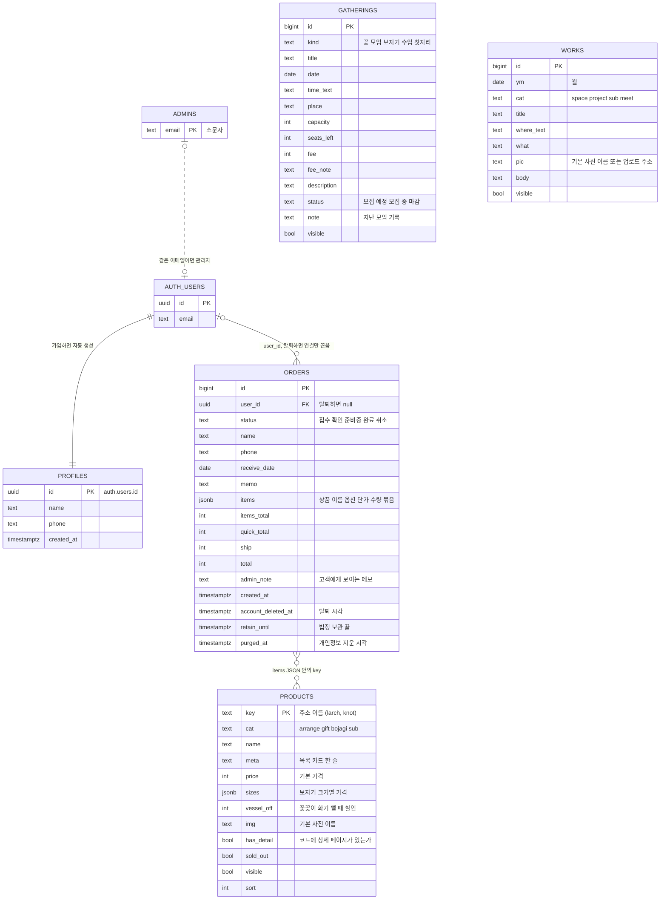
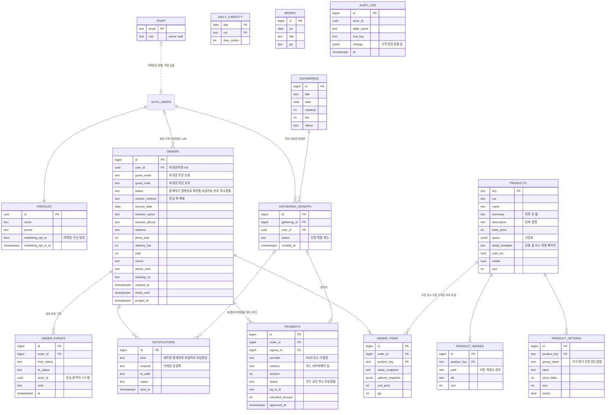

# 설담화 데이터 구조 (ERD)

2026-11-18 기준. 현재 구조는 `supabase/migrations/`에 있는 그대로이고, 목표 구조는 [기능 정의서](https://app.notion.com/p/41c95143816a818ebd0cebf22d140943)의 추천안을 따랐을 때의 모습이다.
플랫폼(카페24·아임웹)을 고르면 회원·주문·결제 쪽은 플랫폼이 대신하므로 목표 구조 중 works·모임 정도만 남는다.

## 현재 구조

DB 함수: `place_order`(가격을 DB에서 다시 계산해 주문 접수), `cancel_my_order`(접수 상태만 본인 취소), `delete_my_account`(탈퇴), `purge_expired_orders`(보관 기간 지난 주문 개인정보 지우기), `is_admin`.
사진 저장소: `works` 버킷(누구나 보기, 관리자만 올리기).

현재 구조의 한계:

- 주문 상품이 `orders.items` JSON에 묶여 있어 상품별 판매량을 세거나 부분 환불을 하기 어렵다.
- 옵션(화기·포장·받는 방법) 금액이 DB 함수와 코드에 박혀 있어, 관리자가 바꿀 수 없다.
- 상세 설명·사진·사양이 코드에 있어 새 상품은 상세 페이지 없이 목록에만 보인다.
- 결제·모임 신청·알림 기록이 없다.

## 목표 구조

## 바뀌는 점과 기다리는 결정

| 바뀌는 점 | 이유 | 기다리는 결정 (기능 정의서) |
| --- | --- | --- |
| 주문 상품을 `order_items`로 분리 | 상품별 집계, 부분 환불 | 없음 (직접 개발이면 진행) |
| `product_options`, `product_images`, 상세 설명을 DB로 | 관리자가 새 상품을 상세 페이지까지 만들 수 있게 | 4장 관리자가 고칠 범위 |
| 주문 상태를 6단계로 | 결제·알림·마이페이지의 기준 | 1장 주문 흐름 |
| `payments` 추가 | PG 승인·환불 기록 | 1장 돈 받는 방식, 6장 연동 방식 |
| 비회원 주문 칸 | 가입 없이 주문 | 3장 비회원 주문 |
| `daily_capacity` 추가 | 날짜별 제작 한도 | 2장 하루 한도 |
| `gathering_signups` 추가 | 모임 신청과 자리 관리 | 2장 모임 신청 방식 |
| `admins` → `staff`(역할) | 대표·스태프 권한 구분 | 5장 역할 구분 |
| `order_events`, `audit_log` | 누가 언제 무엇을 바꿨는지 | 5장 기록 남기기 |
| `notifications` | 보낸 알림 기록, 다시 보내기 | 6장 알림 채널 |
| 마케팅 수신 동의 칸 | 정보통신망법상 별도 동의 | 3장 모으는 정보 |
